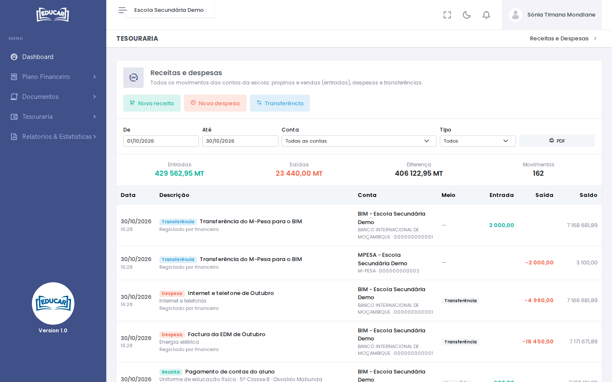
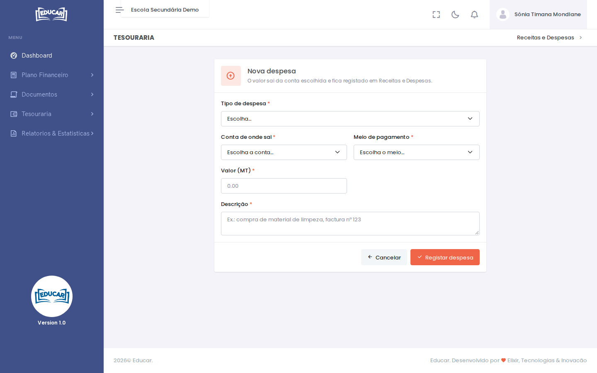

# Receitas e Despesas

**Menu:** Tesouraria › Receitas e Despesas
**Quem vê:** Director financeiro, Funcionário das finanças

Todos os movimentos das contas da escola: as entradas (propinas, vendas, cobranças), as despesas e as transferências entre contas. Aqui também se registam as despesas e as transferências.

## Procurar movimentos

Escolha o período (**De**, **Até**), a **Conta** e o **Tipo** (receita, despesa ou transferência). O topo soma as **Entradas**, as **Saídas** e a **Diferença** do que está na lista.

Cada movimento mostra a data e a hora, a descrição (e o aluno, se houver), quem o registou, a conta, o meio de pagamento, o valor e o **Saldo** da conta depois do movimento.

**PDF** imprime a lista com os mesmos filtros.

!!! note "Receitas"
    As receitas não se registam aqui. As propinas e outras contas dos alunos recebem-se na ficha do aluno, e as vendas na [Venda ao Balcão](venda-ao-balcao.md). **Nova receita** abre a Venda ao Balcão.

## Registar uma despesa

1. Use **Nova despesa**.
2. Escolha o **Tipo de despesa**, por exemplo `Energia elétrica` ou `Salários`. Os tipos são as despesas de [Serviços e Preços](../plano-financeiro/servicos-e-precos.md).
3. Escolha a **Conta de onde sai** o dinheiro e o **Meio de pagamento**.
4. Escreva o **Valor (MT)** e a **Descrição**, por exemplo `Factura da EDM de Outubro`.
5. Use **Registar despesa**.

## Transferir entre contas

Por exemplo, para passar para o banco o dinheiro recebido no M-Pesa ou no caixa.

1. Use **Transferência**. O botão só aparece quando a escola tem mais de uma conta.
2. Escolha a **Conta de saída** e a **Conta de entrada**, que tem de ser diferente.
3. Escreva o **Valor (MT)** e a **Descrição**.
4. Use **Registar transferência**.

A transferência fica nas duas contas: sai de uma e entra na outra. Não conta como receita nem como despesa no [Fecho de Caixa](../relatorios-e-estatisticas/fecho-de-caixa.md).
