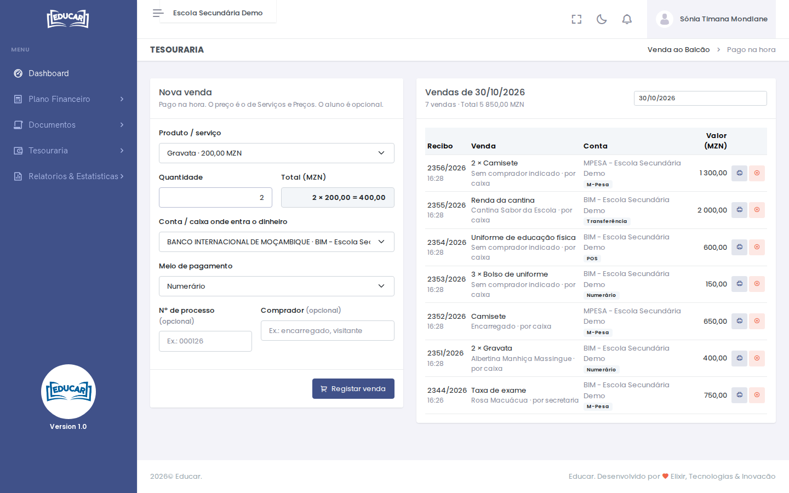
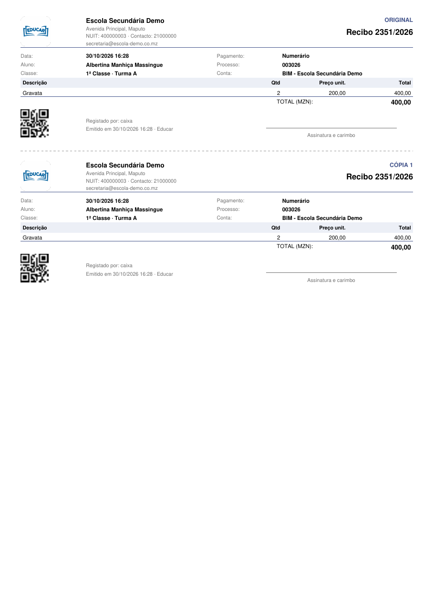

# Venda ao Balcão

**Menu:** Tesouraria › Venda ao Balcão
**Quem vê:** Director financeiro, Funcionário das finanças

Para vender e receber na hora, por exemplo gravatas, camisetes, uniformes, a renda da cantina ou uma guia de transferência. O recibo sai logo. O comprador pode não ser aluno.

Para cobrar a um aluno ou a uma turma uma conta que pagam depois, use [Cobranças a Alunos](cobrancas-a-alunos.md).

## Registar uma venda

1. Escolha o **Produto / serviço**. O preço é o de [Serviços e Preços](../plano-financeiro/servicos-e-precos.md). Um produto **sem preço** não se pode vender.
2. Escreva a **Quantidade**. O **Total** calcula-se sozinho.
3. Escolha a **Conta / caixa onde entra o dinheiro** e o **Meio de pagamento**: numerário, POS, depósito, transferência, M-Pesa ou e-Mola.
4. Se a venda for a um aluno, escreva o **Nº de processo**. O nome do aluno aparece por baixo. Também pode escrever o nome do **Comprador**, por exemplo `Encarregado`.
5. Use **Registar venda**.

A venda entra no saldo da conta e no [Fecho de Caixa](../relatorios-e-estatisticas/fecho-de-caixa.md). Para imprimir o recibo, use **Imprimir recibo** na mensagem de confirmação.

## As vendas do dia

À direita estão as vendas do dia, com o recibo, quem a registou, a conta, o meio e o valor. Para ver outro dia, mude a data. O ícone da impressora volta a abrir o recibo.

## Anular uma venda

1. Use o ícone vermelho da venda.
2. Escreva o motivo e use **Anular venda**.

O valor sai da conta onde entrou. A venda fica na lista como **Anulada**, com quem a anulou, quando e porquê.

!!! warning "Vendas de dias anteriores"
    As vendas do próprio dia anula quem regista vendas. As de dias anteriores só o Director financeiro anula.
