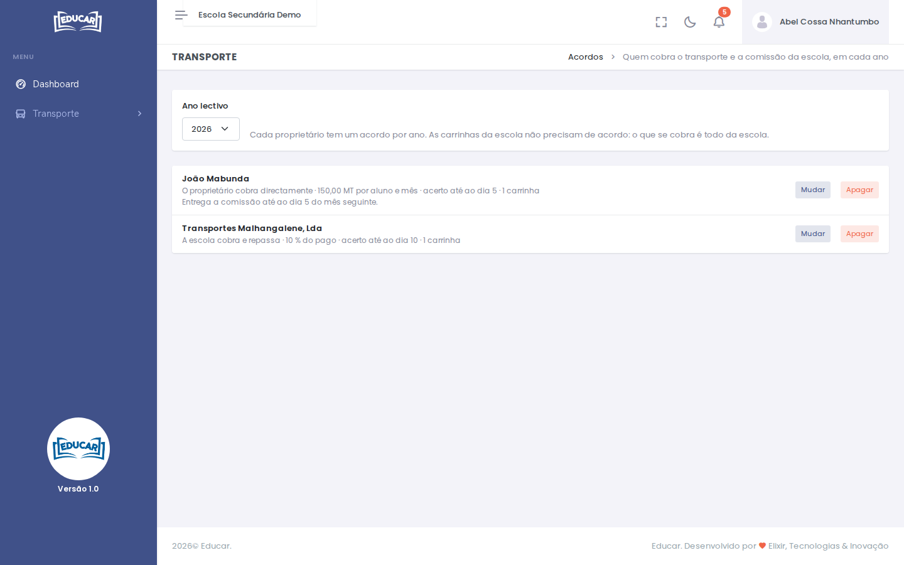

# Acordos

**Menu:** Transporte › Acordos
**Quem vê:** Gestor do transporte, Director, Director pedagógico, Director financeiro, Funcionário das finanças, Chefe da secretaria, Funcionário da secretaria
**Quem regista e muda:** Gestor do transporte, Director

O acordo de cada ano com cada proprietário: quem cobra o transporte ao encarregado e quanto fica para a escola. As carrinhas da escola não precisam de acordo: o que se cobra é todo da escola.

## Registar o acordo

1. Escolha o **Ano lectivo**. Os proprietários sem acordo nesse ano aparecem no topo; use **Registar acordo**.
2. Escolha o **Proprietário**.
3. Em **Quem cobra ao encarregado**, escolha:
    - **A escola cobra e repassa**: as mensalidades entram nas contas dos alunos e a escola paga ao proprietário o que foi pago, menos a comissão;
    - **O proprietário cobra directamente**: a escola não cobra; o proprietário entrega à escola a comissão.
4. Em **Comissão da escola**, escolha **Sem comissão**, **Percentagem do pago** (por exemplo 10 %) ou **Valor fixo por aluno e mês** (por exemplo 150 MT), e escreva o valor.
5. Indique o **Dia do acerto**: a partir desse dia, todos os meses, as finanças são avisadas do acerto por fazer.
6. Use **Gravar o acordo**.

Um proprietário sem acordo no ano não pode ter alunos inscritos nas suas carrinhas.

## Exemplo

Uma carrinha particular tem 20 alunos a 1 500 MT, a escola cobra e a comissão é de 10 %. Em Março pagam 18 alunos: 27 000 MT. No acerto, a escola fica com 2 700 MT e paga 24 300 MT ao proprietário. Os dois meses em dívida entram no acerto do mês em que forem pagos.

## Copiar do ano anterior

Num ano ainda sem acordos, **Copiar do ano anterior** copia os acordos dos proprietários que ainda trabalham com a escola. Reveja os valores.
