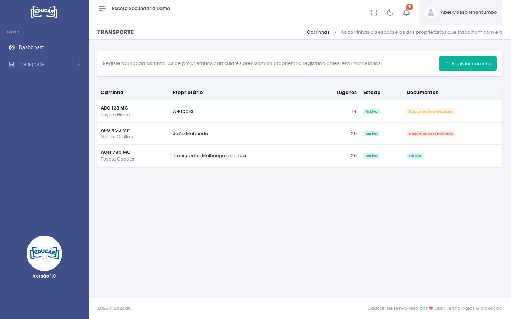
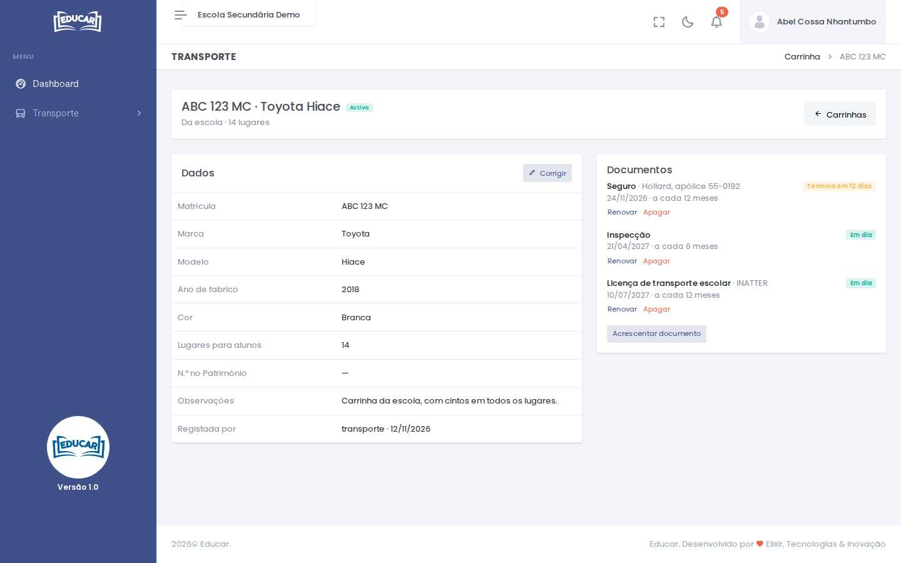

# Carrinhas

**Menu:** Transporte › Carrinhas
**Quem vê:** Gestor do transporte, Director, Director pedagógico, Director financeiro, Funcionário das finanças, Chefe da secretaria, Funcionário da secretaria
**Quem regista e corrige:** Gestor do transporte, Director

As carrinhas da escola e as dos proprietários que trabalham com ela, com o estado dos documentos de cada uma.

## Registar uma carrinha

1. Use **Registar carrinha**.
2. Escreva a **Matrícula**, a **Marca**, o **Modelo**, o **Ano de fabrico** e a **Cor**.
3. Indique os **Lugares para alunos**: é a lotação das rotas que a carrinha faz.
4. Em **Proprietário**, deixe **A escola** ou escolha o proprietário. Os proprietários registam-se antes, em [Proprietários](proprietarios.md).
5. Numa carrinha da escola, pode indicar o **N.º no Património**: as avarias, as reparações e os custos ficam na ficha do bem.
6. Use **Registar a carrinha**.

A matrícula não pode repetir-se na escola.

A carrinha de um proprietário é uma só, mesmo que trabalhe em várias escolas: registar a matrícula de uma carrinha do mesmo proprietário que já está noutra escola associa-a a esta escola, com os dados, os documentos e os motoristas que já tinha. A ficha avisa quando a carrinha trabalha também noutras escolas: as correcções valem para todas. A mesma carrinha não pode fazer duas rotas no mesmo turno, nem em escolas diferentes.

## Ficha da carrinha

A ficha mostra os dados e os documentos. **Corrigir** muda os dados e o **Estado**: Activa, Em manutenção ou Inactiva. Uma carrinha inactiva não pode estar numa rota em funcionamento e deixa de dar avisos dos documentos.

## Documentos

No quadro **Documentos**, use **Acrescentar documento**:

1. Escolha o **Tipo**: seguro, inspecção, licença de transporte escolar, imposto do veículo, manutenção ou outro.
2. Escreva uma **Descrição**, se ajudar (a seguradora e o número da apólice).
3. Indique **Válido até**, se **Renova-se** (uma só vez, ou a cada 1 a 36 meses) e com quantos dias de antecedência avisar (30 por omissão).

Quando o documento é renovado, use **Renovar**: a data proposta já é a seguinte. Os documentos de todas as carrinhas estão em [Documentos](documentos.md).
