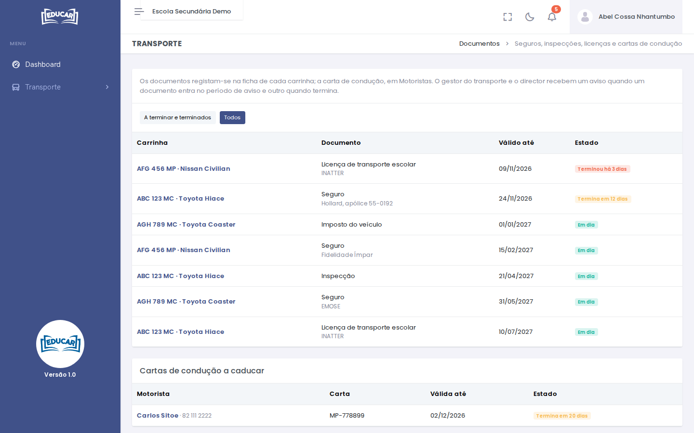

# Documentos

**Menu:** Transporte › Documentos
**Quem vê:** Gestor do transporte, Director, Director pedagógico, Director financeiro, Funcionário das finanças, Chefe da secretaria, Funcionário da secretaria

Os seguros, as inspecções, as licenças e os outros documentos com validade das carrinhas em uso, e as cartas de condução dos motoristas que estão a caducar. **A terminar e terminados** mostra só o que precisa de atenção; **Todos** mostra também os documentos em dia.

Cada documento tem um estado: **Em dia**, **Termina em N dias** ou **Terminou há N dias**.

## Avisos

O gestor do transporte e o director recebem dois avisos no sino, e por email se a escola os enviar: quando o documento entra no período de aviso e quando termina. Para a carta de condução, o aviso chega 30 dias antes de caducar. Cada aviso segue uma só vez; renovar o documento ou actualizar a validade da carta volta a armar os avisos.

Os documentos registam-se na ficha de cada [carrinha](carrinhas.md#documentos); a validade da carta, em [Motoristas](motoristas.md).
