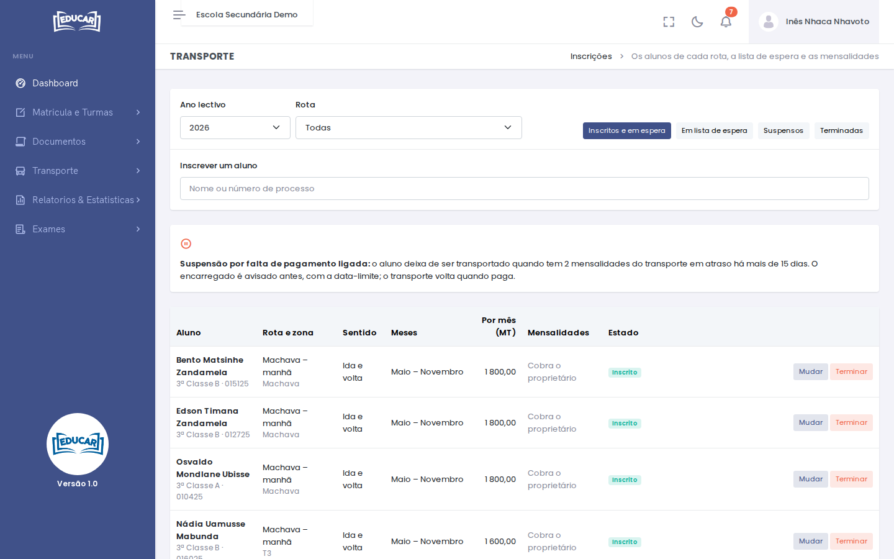
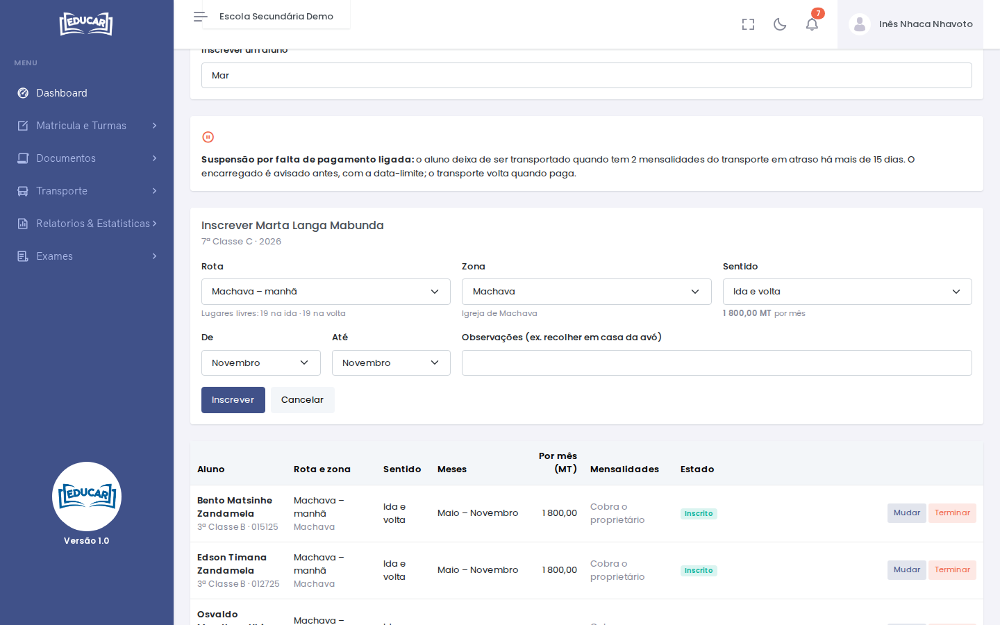
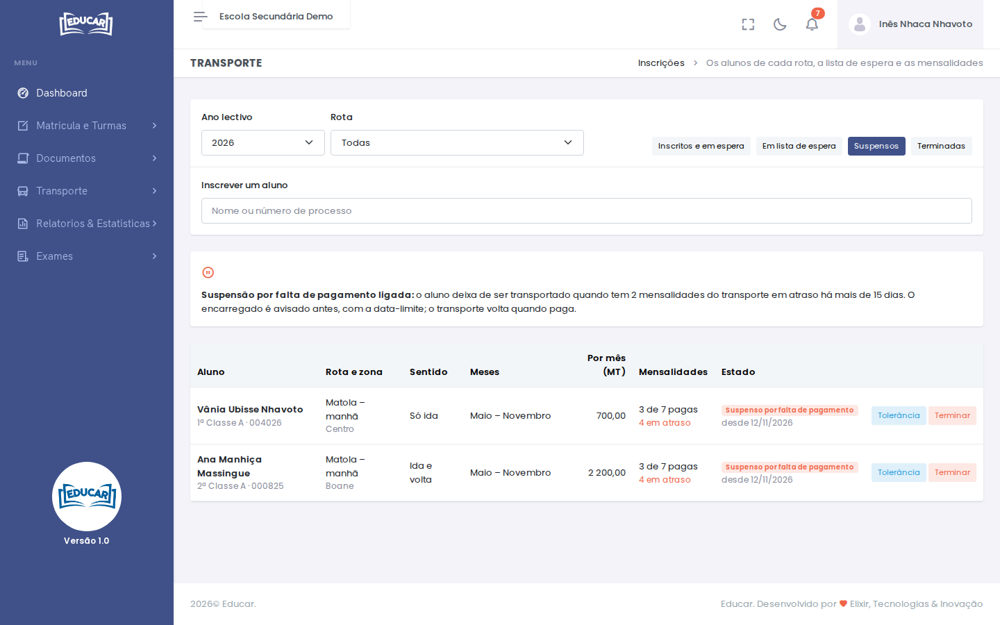

# Inscrições

**Menu:** Transporte › Inscrições
**Quem vê:** Gestor do transporte, Director, Director pedagógico, Director financeiro, Funcionário das finanças, Chefe da secretaria, Funcionário da secretaria
**Quem inscreve, muda e termina:** Gestor do transporte, Director, Chefe da secretaria, Funcionário da secretaria

Os alunos de cada rota, a lista de espera e as mensalidades do transporte. Escolha o **Ano lectivo** e, se quiser, uma **Rota**. Os separadores mostram os inscritos e os que estão em espera, só a lista de espera, os suspensos por falta de pagamento ou as inscrições terminadas.

Em cada inscrição vê a rota e a zona, o sentido, os meses, o preço por mês e quantas mensalidades estão pagas e em atraso. Quando a carrinha é de um proprietário que cobra directamente, aparece **Cobra o proprietário**: essas mensalidades não passam pela escola.

## Inscrever um aluno

1. Em **Inscrever um aluno**, escreva o nome ou o número de processo e use **Inscrever** no aluno certo.
2. Escolha a **Rota**: aparecem os lugares livres na ida e na volta.
3. Escolha a **Zona**: aparece o ponto de recolha.
4. Escolha o **Sentido**: ida e volta, só ida ou só volta. Só aparecem os sentidos que têm preço nessa zona, e o preço do mês aparece logo.
5. Escolha os meses (**De** e **Até**) e escreva uma observação, se for preciso (por exemplo "recolher em casa da avó").
6. Use **Inscrever**.

Quando é a escola que cobra, as mensalidades do transporte entram logo nas contas do aluno, uma por mês ("Transporte escolar · Março 2026"), com a mesma data-limite da propina desse mês. Pagam-se na secretaria como as outras contas, com recibo.

O preço fica o da inscrição: mudar depois o preço da zona não muda as inscrições já feitas.

O aluno e os encarregados com conta na app são avisados da inscrição, e o encarregado recebe também o aviso por email, se a escola enviar emails.

## Lista de espera

Quando a rota está cheia no sentido escolhido, o aluno fica **Em lista de espera**, sem mensalidades. Quando um aluno sai da rota, o gestor do transporte e o chefe da secretaria recebem um aviso com o primeiro da lista. Use **Dar o lugar**: as mensalidades começam a contar no mês seguinte, e o encarregado é avisado.

## Mudar de rota, zona ou sentido

Use **Mudar** na inscrição, escolha a nova rota, zona e sentido e o mês **A partir de**. Até lá fica tudo como estava; as mensalidades por pagar dos meses seguintes passam para o preço novo. Se algum desses meses já estiver pago, a mudança é recusada.

## Terminar uma inscrição

Use **Terminar**, escolha o mês a partir do qual o aluno deixa de usar o transporte e escreva o motivo (mudou de casa, desistiu…). As mensalidades por pagar desses meses apagam-se; as pagas ficam. Uma inscrição feita por engano, sem nada pago, pode terminar-se desde o primeiro mês e fica **Anulada**.

## Suspensão por falta de pagamento

A escola pode suspender o transporte de quem não paga, com tolerância. O quadro no topo da página mostra a regra; o gestor do transporte e o director mudam-na em **Mudar a regra**:

- **Suspender por falta de pagamento**: liga ou desliga a regra (vem desligada);
- **Mensalidades em atraso**: quantas mensalidades do transporte por pagar levam à suspensão (por omissão, 2);
- **Dias de tolerância depois da data-limite**: quantos dias se espera depois da data-limite de cada mensalidade (por omissão, 15).

Com a regra ligada, de hora a hora:

1. Quando a suspensão se aproxima, o aluno e os encarregados são avisados com a data em que o transporte fica suspenso se não pagarem.
2. Passada a tolerância, a inscrição fica **Suspensa por falta de pagamento**. O aluno sai da lista do motorista (aparece à parte, como "não transportar"), mas mantém o lugar e as mensalidades. O encarregado, o gestor do transporte e o chefe da secretaria são avisados.
3. Quando as contas ficam em dia, a suspensão levanta-se sozinha e o encarregado é avisado.

Para uma família com dificuldades, use **Tolerância** na inscrição e escolha a data até à qual o aluno não é suspenso (no máximo 90 dias). Num aluno já suspenso, a suspensão levanta-se logo.

Desligar a regra levanta todas as suspensões na hora seguinte.
