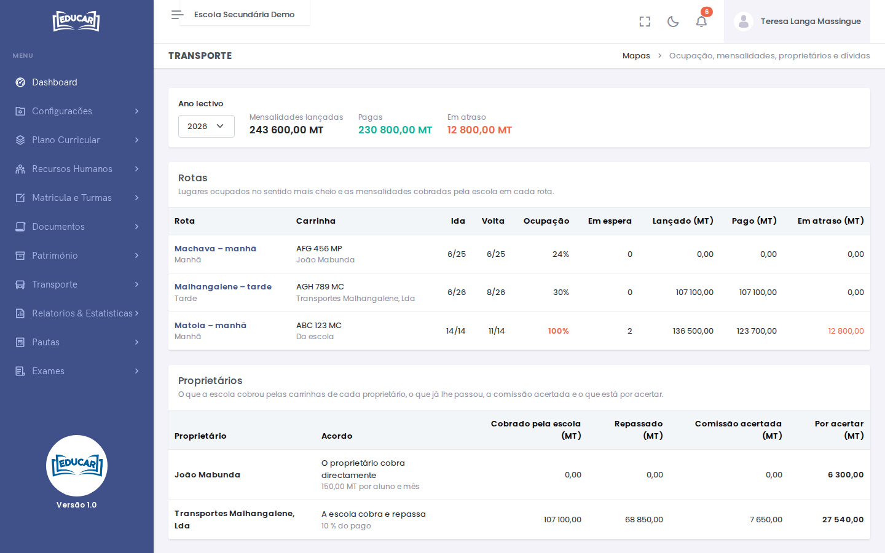

# Mapas

**Menu:** Transporte › Mapas
**Quem vê:** Gestor do transporte, Director, Director pedagógico, Director financeiro, Funcionário das finanças, Chefe da secretaria, Funcionário da secretaria

O resumo do transporte no ano lectivo escolhido. No topo, as mensalidades do transporte lançadas, pagas e em atraso.

- **Rotas**: os lugares ocupados na ida e na volta, a ocupação (a laranja a partir de 85 %, a vermelho quando a rota está cheia), os alunos em espera e as mensalidades lançadas, pagas e em atraso de cada rota.
- **Proprietários**: o que a escola cobrou pelas carrinhas de cada proprietário, o que já lhe passou, a comissão acertada e o que está por acertar (a pagar ou a receber).
- **Alunos com mensalidades em atraso**: o encarregado e o contacto, quantos meses, desde quando e quanto.
