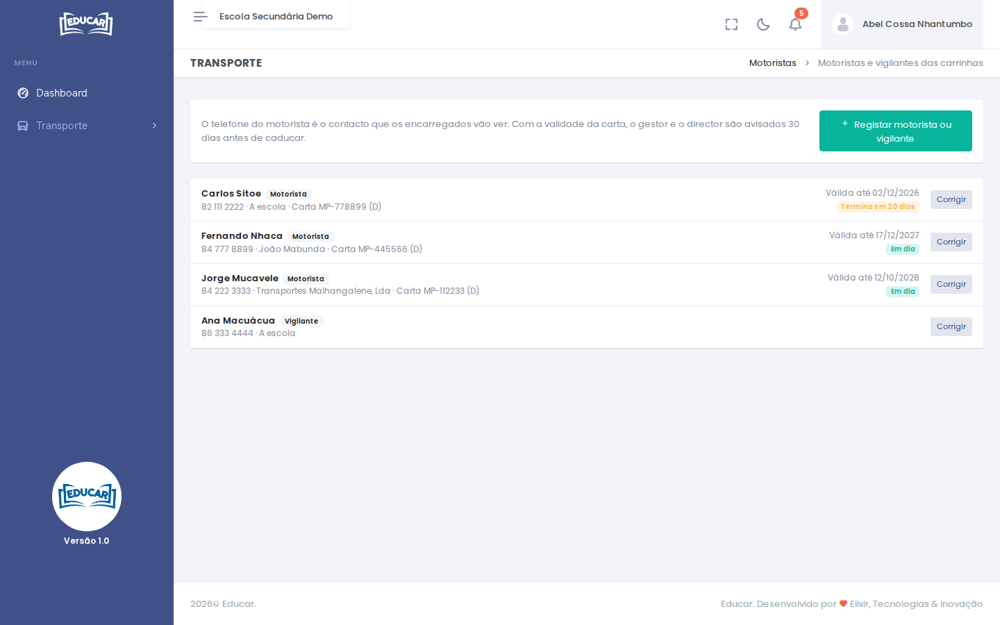

# Motoristas

**Menu:** Transporte › Motoristas
**Quem vê:** Gestor do transporte, Director, Director pedagógico, Director financeiro, Funcionário das finanças, Chefe da secretaria, Funcionário da secretaria
**Quem regista e corrige:** Gestor do transporte, Director

Os motoristas e os vigilantes das carrinhas, da escola ou dos proprietários.

## Registar

1. Use **Registar motorista ou vigilante**.
2. Escreva o **Nome** e escolha a **Função**: motorista ou vigilante.
3. Escreva o **Telefone**: é o contacto que os encarregados vêem na app.
4. Em **Trabalha para**, deixe **A escola** ou escolha o proprietário.
5. Num motorista, indique o **N.º da carta de condução**, a **Categoria** e **Carta válida até**.
6. Use **Registar**.

Com a validade da carta, o gestor do transporte e o director são avisados 30 dias antes de caducar, e a carta aparece em [Documentos](documentos.md).

Quem deixa de trabalhar nas carrinhas fica fora do activo: use **Corrigir** e desligue **No activo**. Deixa de aparecer nas rotas novas e de dar avisos.
