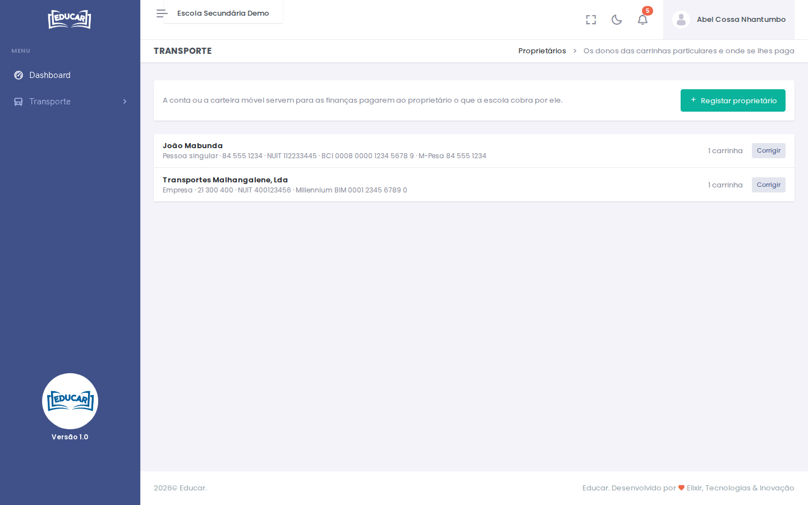

# Proprietários

**Menu:** Transporte › Proprietários
**Quem vê:** Gestor do transporte, Director, Director pedagógico, Director financeiro, Funcionário das finanças, Chefe da secretaria, Funcionário da secretaria
**Quem regista e corrige:** Gestor do transporte, Director

Os donos das carrinhas particulares que trabalham com a escola, pessoas ou empresas, e onde se lhes paga.

## Registar um proprietário

1. Use **Registar proprietário**.
2. Escreva o **Nome**, escolha o **Tipo** (pessoa singular ou empresa) e o **Telefone**.
3. Se tiver, escreva o **NUIT** (9 algarismos), o **Email** e a **Morada**.
4. Indique onde se lhe paga: o **Banco** e a **Conta ou NIB**, ou a carteira **M-Pesa / e-Mola**. As finanças vêem estes dados no acerto.
5. Use **Registar o proprietário**.

Depois registe as suas [carrinhas](carrinhas.md) e o [acordo do ano](acordos.md).

Um proprietário que deixa de trabalhar com a escola não se apaga: use **Corrigir** e desligue **Trabalha com a escola**. Deixa de aparecer nas carrinhas e nos acordos novos.
