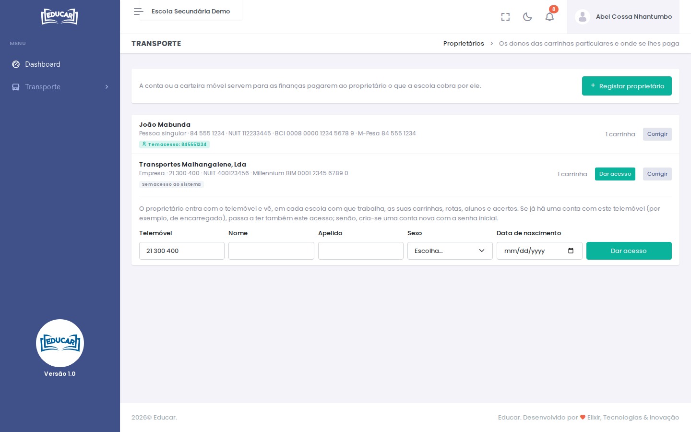

# Proprietários

**Menu:** Transporte › Proprietários
**Quem vê:** Gestor do transporte, Director, Director pedagógico, Director financeiro, Funcionário das finanças, Chefe da secretaria, Funcionário da secretaria
**Quem regista e corrige:** Gestor do transporte, Director

Os donos das carrinhas particulares que trabalham com a escola, pessoas ou empresas, e onde se lhes paga.

## Registar um proprietário

1. Use **Registar proprietário**.
2. Escreva o **Nome**, escolha o **Tipo** (pessoa singular ou empresa) e o **Telefone**.
3. Se tiver, escreva o **NUIT** (9 algarismos), o **Email** e a **Morada**.
4. Indique onde se lhe paga: o **Banco** e a **Conta ou NIB**, ou a carteira **M-Pesa / e-Mola**. As finanças vêem estes dados no acerto.
5. Use **Registar o proprietário**.

Depois registe as suas [carrinhas](carrinhas.md) e o [acordo do ano](acordos.md).

Um proprietário que já trabalha com outra escola no EDUCAR é o mesmo registo: ao registá-lo com o mesmo NUIT, fica associado também a esta escola, com os dados que já tinha. Os seus dados, as carrinhas, os documentos e os motoristas são os mesmos em todas as escolas; os acordos, as rotas e os alunos são de cada escola.

## Dar acesso ao proprietário

O proprietário pode ter conta no EDUCAR, no site e na app, para acompanhar as suas carrinhas, rotas, alunos e acertos e fazer algumas mudanças (ver [Proprietário](../proprietario/index.md)).

1. Use **Dar acesso** no proprietário.
2. Escreva o **Telemóvel** com que vai entrar.
3. Se ainda não há conta com esse telemóvel, escreva o nome, o apelido, o sexo e a data de nascimento da pessoa que vai usar a conta.
4. Use **Dar acesso**. A mensagem mostra o utilizador e a senha inicial, para entregar ao proprietário; ele muda a senha na primeira entrada.

Se já há uma conta com o telemóvel (por exemplo, de encarregado de educação), essa conta passa a ter também o acesso de proprietário. O proprietário com acesso aparece com **Tem acesso**. A conta tem o acesso em todas as escolas com que o proprietário trabalha.

O gestor do transporte é avisado das mudanças que o proprietário faz.

Um proprietário que deixa de trabalhar com a escola não se apaga: use **Corrigir** e desligue **Trabalha com a escola**. Deixa de aparecer nas carrinhas e nos acordos novos.
