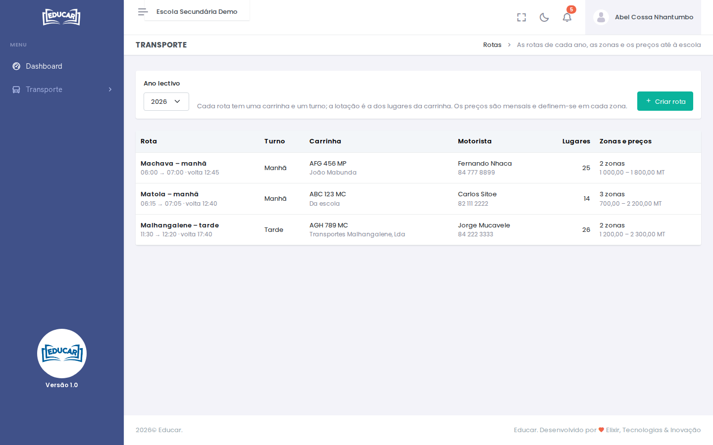
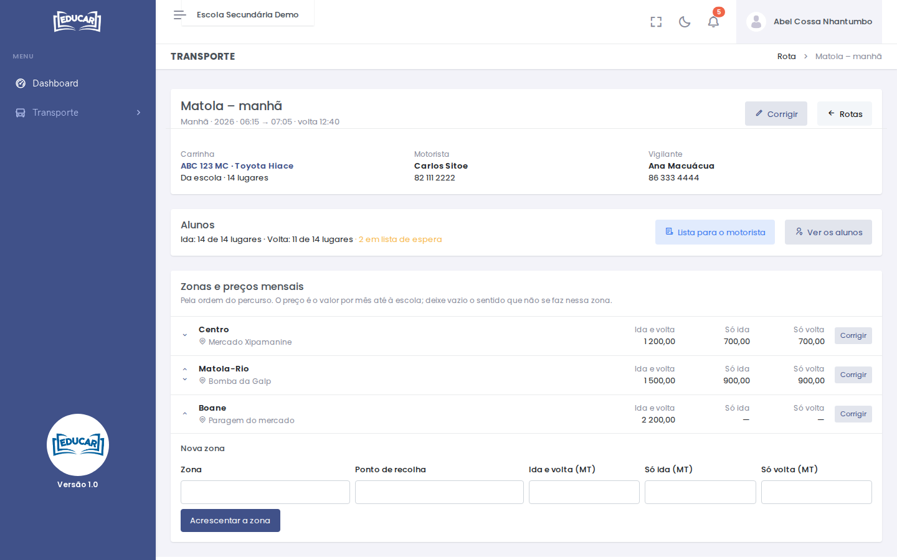
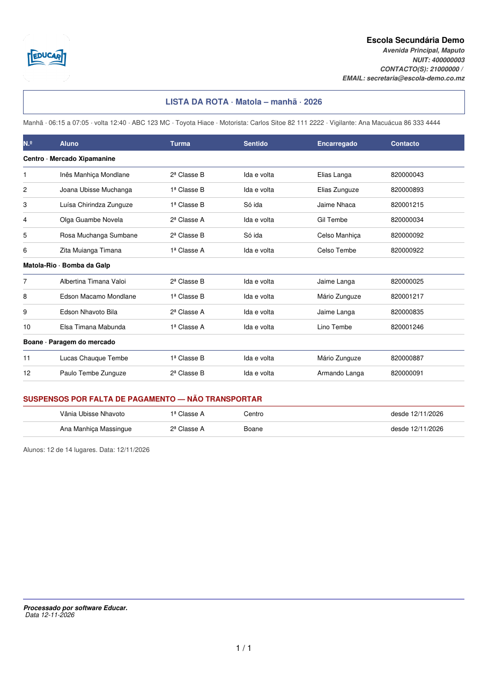

# Rotas

**Menu:** Transporte › Rotas
**Quem vê:** Gestor do transporte, Director, Director pedagógico, Director financeiro, Funcionário das finanças, Chefe da secretaria, Funcionário da secretaria
**Quem cria e muda:** Gestor do transporte, Director

As rotas de cada ano lectivo. Cada rota tem uma carrinha, um turno e as horas; a lotação é a dos lugares da carrinha. Os preços definem-se em cada zona.

## Criar uma rota

1. Escolha o **Ano lectivo** e use **Criar rota**.
2. Dê o **Nome da rota** (por exemplo "Matola – manhã") e escolha o **Turno**: manhã, tarde, noite ou dia inteiro.
3. Escolha a **Carrinha**, o **Motorista** e, se houver, o **Vigilante**.
4. Indique as horas: **Partida (ida)** da primeira paragem, **Chegada à escola** e **Saída da escola** na volta.
5. Use **Criar a rota**.

A mesma carrinha não pode fazer duas rotas no mesmo turno, mas pode fazer a rota da manhã e a da tarde.

## Zonas e preços

Na ficha da rota, acrescente as zonas pela ordem do percurso. Cada zona tem o **Ponto de recolha** e o preço por mês até à escola em cada sentido: **Ida e volta**, **Só ida** e **Só volta**. Deixe vazio o sentido que não se faz nessa zona. As setas mudam a ordem das zonas; **Zona servida** desligada tira a zona das novas inscrições.

O quadro **Alunos** mostra os lugares ocupados na ida e na volta e quantos alunos estão em espera. **Ver os alunos** abre as inscrições da rota.

## Lista para o motorista

**Lista para o motorista** imprime os alunos da rota por zona, pela ordem do percurso, com a turma, o sentido e o contacto do encarregado. Os alunos suspensos por falta de pagamento aparecem à parte, como "não transportar".

## Mudar a carrinha ou o motorista

Use **Corrigir** na ficha da rota. Quando muda a carrinha ou o motorista, o aluno e os encarregados de todos os inscritos são avisados, com a matrícula da carrinha e o telefone do motorista. **Rota em funcionamento** desligada pára a rota.

## Copiar do ano anterior

Num ano ainda sem rotas, **Copiar do ano anterior** copia as rotas em funcionamento, com as zonas e os preços. Ficam de fora as rotas com um nome que já existe e as de carrinhas inactivas. Reveja os preços antes de inscrever os alunos.
