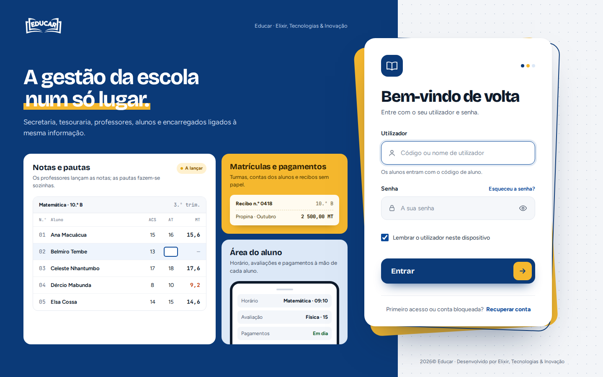

# Entrar no sistema

1. Abra o endereço do EDUCAR que a sua escola lhe deu.
2. Escreva o seu utilizador e a sua senha e use **Entrar**.
3. Se trabalhar em mais do que uma escola, escolha a escola com que vai trabalhar. Os menus que vê dependem do seu perfil nessa escola.

## Sessão

Por segurança, a sessão termina depois de **15 minutos sem actividade**. Basta entrar de novo.

## Senha inicial

Se entrar com a senha inicial que a escola lhe deu, o sistema pede-lhe logo uma senha nova, com pelo menos 8 caracteres e diferente da inicial. Até a mudar, não abre mais nenhum ecrã.

## Mudar a senha

No seu nome, no topo do ecrã, escolha **Mudar a senha**.

## Língua

O EDUCAR fala português e inglês. No seu nome, no topo do ecrã, escolha **Português** ou **English**: a escolha fica no seu perfil e vale também na app. Antes de entrar, pode escolhê-la no canto do cartão de entrada.

Os menus, o painel inicial e os ecrãs de entrada já estão nas duas línguas; os outros ecrãs vão sendo traduzidos e, até lá, aparecem em português. Os documentos oficiais (pautas, recibos, declarações) e os dados da escola, como os nomes das disciplinas, ficam sempre em português.

## Sair

No seu nome, no topo do ecrã, escolha **Sair**. Faça-o sempre num computador partilhado.
